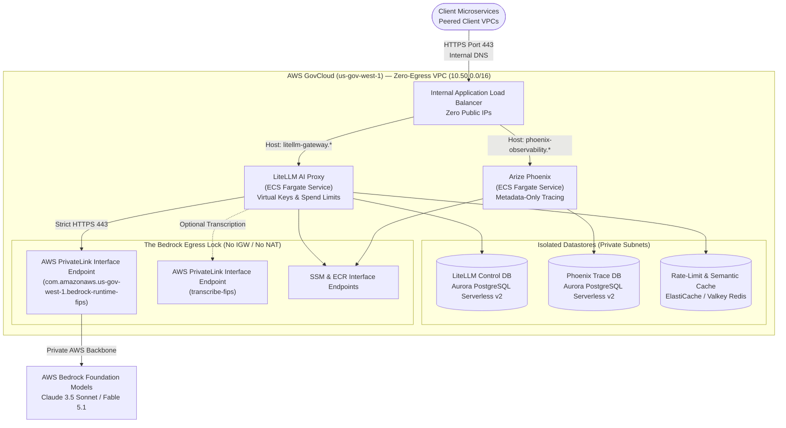

# Enterprise AWS GovCloud AI Platform: LiteLLM Gateway & Arize Phoenix (Terraform)

[](https://www.terraform.io/)
[](https://registry.terraform.io/providers/hashicorp/aws/latest)
[](#nist-sp-800-53-rev-5-compliance-matrix)
[](tests/)

Production-grade Infrastructure as Code (Terraform) deploying a **FedRAMP High & NIST SP 800-53 Rev 5 compliant Enterprise AI Platform** in **AWS GovCloud (`us-gov-west-1`)**.

The platform provisions a centralized **LiteLLM Gateway** and self-hosted **Arize Phoenix** observability suite on **AWS ECS Fargate**, hardened with a hardware/network-enforced **Bedrock Egress Lock** that prevents unauthorized model calls, external data exfiltration, and unmonitored API spend.

---

## 1. Architectural Architecture Diagram



---

## 2. Core Architectural Pillars

### 2.1 The Bedrock Egress Lock (Zero-Trust Network Isolation)
* **Zero Public Ingress & Zero Internet Egress:** The AI platform VPC is provisioned with **zero Internet Gateways and zero NAT Gateways**. Public internet egress is topologically impossible.
* **PrivateLink Interface Endpoints:** Inbound and outbound AWS API calls (Bedrock, Transcribe, Secrets Manager, CloudWatch Logs, ECR) travel exclusively across Interface VPC Endpoints (`com.amazonaws.us-gov-west-1.bedrock-runtime-fips`).
* **Endpoint Policies & Security Group Chaining:** Bedrock access is restricted strictly to the `litellm` ECS task security group. Even if application containers are compromised, direct calls to Bedrock from outside the proxy are blocked at the network layer.

### 2.2 LiteLLM Enterprise Gateway
* **Single Network Egress to Foundation Models:** All internal client microservices invoke foundation models through the internal LiteLLM proxy via private Route53 DNS.
* **Virtual Keys & FinOps Budgets:** Issues scoped virtual API keys with enforced monthly budgets, rate limits, and model access whitelists.
* **Semantic Caching & Token Bucket Rate-Limiting:** Backed by an ElastiCache (Valkey/Redis) replication group with SSM-injected AUTH tokens, dramatically lowering inference latency and LLM token costs.

### 2.3 Arize Phoenix (Metadata-Only Observability)
* **Self-Hosted Tracing:** Deploys Arize Phoenix on ECS Fargate backed by Aurora PostgreSQL Serverless v2 for OpenTelemetry tracing, latency tracking, and evaluation.
* **Content Suppression (Zero PHI/PII Ingestion):** Configured to capture metadata only (token counts, latency, status codes, user tags) while suppressing raw prompt and response text to comply with healthcare and defense data sovereignty mandates.

### 2.4 FedRAMP High & NIST SP 800-53 Rev 5 Hardening
* **No Inline Role Policies (`iam-no-inline-policy-check` compliant):** Converts all IAM policies to customer-managed policies with least-privilege scoping (zero `Resource = "*"` on model ARNs).
* **FIPS 140-3 Endpoint Enforcement:** Configured by default to target AWS GovCloud FIPS endpoints (`bedrock-runtime-fips`, `transcribe-fips`).
* **Cryptographic Data Protection:** Customer Managed Keys (KMS CMK) with automatic 365-day rotation encrypting RDS clusters, ElastiCache, Secrets Manager, and CloudWatch log groups.

---

## 3. Comprehensive Engineering Documentation

The repository includes formal, production-grade architectural specifications:

* 📄 **[`docs/SDD.md`](docs/SDD.md):** Full System Design Document detailing architecture, blast-radius boundaries, VPC peering seams, and datastore topologies.
* 🛡️ **[`docs/NIST_800_53_CONTROLS.md`](docs/NIST_800_53_CONTROLS.md):** Formal compliance traceability matrix mapping each resource to NIST SP 800-53 Rev 5 controls (AC, AU, CM, CP, IA, SC, SI).
* 🔌 **[`docs/INTERFACE_CONTRACTS.md`](docs/INTERFACE_CONTRACTS.md):** Technical interface specifications for client services, virtual key provisioning, and telemetry schemas.
* 🔄 **[`docs/KEY_ROTATION_BACKUP.md`](docs/KEY_ROTATION_BACKUP.md):** Annual cryptographic key rotation and disaster recovery procedures.
* 📖 **[`docs/RUNBOOKS.md`](docs/RUNBOOKS.md):** Operational runbooks for incident response, container restarts, and cache flushes.

---

## 4. Automated Testing & Verification Suite

This repository includes native **Terraform 1.6+ integration tests** and automated negative egress assertions in [`tests/`](tests/):

1. **`assurance.tftest.hcl`:** Native Terraform test suite validating plan assertions, customer-managed IAM policies, and private subnet configurations.
2. **`egress-negative.sh`:** Automated shell probe executing within a container task to verify that attempts to reach the public internet or unapproved AWS endpoints fail immediately.
3. **`marker-string.sh`:** Injects canary tokens to verify that Phoenix and CloudWatch log sinks suppress prompt bodies and sensitive content.

Run the test suite:
```bash
# Execute native Terraform assurance tests
terraform test
```

---

## 5. Deployment Runbook

### Prerequisites
1. **Terraform CLI:** `>= 1.6.0`
2. **AWS CLI:** Authenticated with AWS GovCloud credentials (`us-gov-west-1`)
3. **ACM Wildcard Certificate:** Pre-provisioned private or wildcard SSL certificate in AWS Certificate Manager.

### Execution

```bash
# 1. Clone repository
git clone https://github.com/paulkanz/terraform-aws-govcloud-ai-gateway.git
cd terraform-aws-govcloud-ai-gateway

# 2. Copy and configure variables
cp terraform.tfvars.example terraform.tfvars
vim terraform.tfvars

# 3. Initialize Terraform
terraform init

# 4. Review execution plan
terraform plan

# 5. Apply infrastructure
terraform apply
```

---

## 6. License & Maintainer

Maintained by **Paul Kanz** (Staff Platform & Infrastructure Architect).  
Licensed under the Apache License 2.0.
